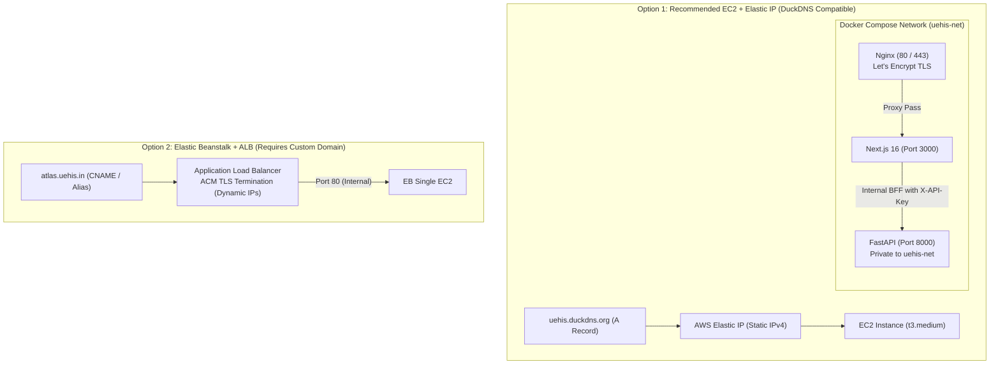

# UEHIS — Production Readiness Architecture, Security & CRUD Specification

**System**: Urban Ecosystem Health Intelligence System (UEHIS)
**Target Infrastructure**: AWS EC2 (`ap-south-1`) with Elastic IP vs. Elastic Beanstalk + ALB
**Domain Strategy**: DuckDNS (`uehis.duckdns.org`) with Let's Encrypt TLS vs. Custom Domain with ACM
**Status**: Comprehensive Plan & Pre-Deployment Review (Read-Only; Pending User Approval)

---

## 1. Website Identity, Domain & TLS Validation Strategy

### Brand Alignment
The project name and brand identity is strictly **UEHIS** (**Urban Ecosystem Health Intelligence System**).
- **Brand Palette**: Forest Green (`#1b4332`), Emerald (`#2d6a4f`), Sage (`#40916c`), Slate (`#1e293b`), Light Neutral (`#f8fafc`).
- **Typography & UI**: Inter / Roboto; strictly functional, frozen scientific presentation without generic SaaS gradients or "vibe coding".
- **Application Metadata**: All HTML titles, OpenGraph tags, manifest records, and report headers consistently declare "UEHIS — Urban Ecosystem Health Intelligence System".

### Domain Evaluation: DuckDNS (`uehis.duckdns.org`)
- **DNS Type**: Dynamic DNS mapping a subdomain to an IPv4 address (`A` record) or IPv6 address (`AAAA` record).
- **TLS Certificate Validation Compatibility**:
  - **AWS Certificate Manager (ACM)**: Incompatible with DuckDNS. ACM requires DNS validation via custom CNAME records (`_x.uehis.duckdns.org` -> `_y.acm-validations.aws.`). DuckDNS does **not** support arbitrary CNAME records.
  - **Let's Encrypt (Certbot)**: **100% Compatible**. Let's Encrypt supports:
    1. **HTTP-01 Challenge**: Automated via Nginx webroot plugin (`/.well-known/acme-challenge/`). Zero DNS API configuration required.
    2. **DNS-01 Challenge**: Supported via DuckDNS TXT record API.
    - Certificates are free, universally trusted by all major browsers, and automatically renewed via Certbot systemd timer.

---

## 2. Restricted SSH Architecture

| Access Method | Configuration & Enforcement | Recommendation |
|---|---|---|
| **AWS Systems Manager (SSM) Session Manager** | • **Zero open inbound ports**: Port 22 is completely closed in the EC2 Security Group.<br>• IAM role (`AmazonSSMManagedInstanceCore`) attached to EC2 instance profile.<br>• Outbound HTTPS (port 443) connection established by SSM Agent.<br>• Full keystroke logging and audit trail in AWS CloudWatch Logs & S3.<br>• Multi-Factor Authentication (MFA) enforced via IAM. | **RECOMMENDED (Gold Standard)** |
| **Restricted Security Group SSH** | • TCP Port 22 allowed **only** from approved admin IP: `<ADMIN_IP>/32` (e.g. `203.0.113.50/32`).<br>• `0.0.0.0/0` and `::/0` strictly prohibited.<br>• Host-level `/etc/ssh/sshd_config`: `PasswordAuthentication no`, `PermitRootLogin no`, `PubkeyAuthentication yes`. | **Approved Fallback** |

---

## 3. Deployment Architecture: Elastic IP vs. Elastic Beanstalk + ALB



### Comparative Analysis:
1. **IP Addressing**:
   - **EC2 + Elastic IP**: Provides a permanent, static public IPv4 address. DuckDNS points an `A` record directly to the Elastic IP (`uehis.duckdns.org -> 13.235.X.X`).
   - **ALB**: Does **not** have a static Elastic IP. ALBs resolve to dynamic AWS IP addresses that change as AWS scales the balancer. DuckDNS does not support CNAME aliases to ALB DNS names (`*.elb.amazonaws.com`).
2. **TLS Termination**:
   - **EC2 + Elastic IP**: Nginx terminates TLS locally using free Let's Encrypt certificates managed by Certbot.
   - **ALB**: ALB terminates TLS using AWS ACM (requires a purchased custom domain with Route 53 / DNS CNAME support).
3. **Monthly Cost**:
   - **EC2 + Elastic IP**: ~$15 to $33 / month (Elastic IP is free when attached to a running instance; Let's Encrypt is free).
   - **ALB + EB**: ~$55 to $60 / month (ALB base fee is ~$16.20/mo + LCU charges even when idle, plus custom domain costs).

**Recommendation**: Deploy on a single EC2 instance with an Elastic IP and Docker Compose. This directly satisfies the DuckDNS requirement, avoids unnecessary ALB costs, and maintains complete TLS and port security.

---

## 4. Nginx Reverse Proxy & Port Isolation

- **Nginx Responsibilities**:
  - Exposes port 80 (HTTP) and port 443 (HTTPS) to the public internet.
  - Redirects all port 80 traffic to HTTPS (`return 301 https://$host$request_uri;`) while exempting `/.well-known/acme-challenge/` for Certbot verification.
  - Proxies HTTPS requests to Next.js (`frontend:3000`).
  - Preserves `$http_x_forwarded_proto` (`https`) so Next.js SSR and Supabase Auth recognize the secure protocol.
  - Configures high-capacity buffer sizes (`proxy_buffer_size 128k; proxy_buffers 4 256k;`) to handle Supabase SSR auth cookies without truncation.
- **Microservice Isolation**:
  - `uehis-api` (FastAPI): Mapped with `expose: ["8000"]` (no host port binding). Port 8000 is isolated to the Docker bridge network `uehis-net`.
  - Next.js acts as the Backend-For-Frontend (BFF). Next.js API routes query FastAPI over the internal network using the `X-API-Key: <UEHIS_API_KEY>` header.
  - Direct public internet access to port 8000 is completely blocked by Docker network isolation and EC2 Security Groups.

---

## 5. TLS / HTTPS Security Configuration

- **Protocols & Ciphers**: Enforce `TLSv1.2` and `TLSv1.3` with ECDHE Perfect Forward Secrecy ciphers. Reject SSLv3, TLS 1.0, and TLS 1.1.
- **Security Headers**:
  - `Strict-Transport-Security: max-age=31536000; includeSubDomains` (1-year HSTS enforcement).
  - `X-Content-Type-Options: nosniff` (MIME-sniffing protection).
  - `X-Frame-Options: DENY` and CSP `frame-ancestors 'none';` (Clickjacking mitigation).
  - `Content-Security-Policy`: Whitelists MapTiler (`api.maptiler.com`), CartoCDN (`basemaps.cartocdn.com`), Geoapify (`api.geoapify.com`), Supabase (`*.supabase.co`), Google Fonts (`fonts.googleapis.com`), and Web Worker `blob:`. Includes `upgrade-insecure-requests;` in production.
- **Cookies**:
  - Supabase session cookies configured with `Secure; HttpOnly; SameSite=Lax`.
- **Database TLS**:
  - FastAPI requires `sslmode=require` (or `verify-full`) via `validate_startup_security()` in `api/security.py`. Insecure database connections fail closed on startup.

---

## 6. Complete CRUD & RLS Governance Matrix

| Entity / Database Table | Create (C) | Read (R) | Update (U) | Delete (D) | Allowed Roles | Governance & Immutability Rules |
|---|---|---|---|---|---|---|
| **`uehi_blocks`** | ❌ None (CLI Pipeline) | ✅ `GET /api/blocks/[id]`, `/api/summary`, MVT tiles | ❌ **FORBIDDEN** | ❌ **FORBIDDEN** | Read: `public` (sanitized), `researcher`/`admin` (full) | **IMMUTABLE SCIENTIFIC BASELINE**: Spatial grid scores, LST, NDVI, and risk classifications computed via frozen pipelines must never be mutated. |
| **`carbon_blocks`** | ❌ None (CLI Pipeline) | ✅ `GET /api/blocks/[id]`, MVT tiles | ❌ **FORBIDDEN** | ❌ **FORBIDDEN** | Read: `public` (aggregate), `researcher`/`admin` (full) | **IMMUTABLE SCIENTIFIC BASELINE**: Standing carbon stock and allometric biomass estimations are immutable baselines. |
| **`data_sources`, `methodology_versions`, `production_runs`** | ❌ None (Migration/Pipeline) | ✅ `GET /api/summary` (provenance metadata) | ❌ **FORBIDDEN** | ❌ **FORBIDDEN** | Read: `public` | **IMMUTABLE PROVENANCE AUDIT**: Cryptographic SHA-256 hashes, git commit anchors, and sensor sources must never be modified or deleted. |
| **`study_areas`** | ✅ `POST /api/study-area` | ✅ RPC Aggregations, `GET /api/profile/activity` | ✅ (RLS owner policy) | ✅ (RLS owner policy) | `authenticated`, `anon` (transient) | **USER ENTITY**: Custom study polygons and point-radius buffers. Users may create, analyze, and manage their own study areas. |
| **`planting_scenarios`** | ❌ (Pre-computed baseline scenarios) | ✅ `GET /api/planting/scenarios` | ❌ **FORBIDDEN** | ❌ **FORBIDDEN** | Read: `public` | **STANDARDIZED BENCHMARKS**: Baseline scenario intervention parameters (e.g. 500 units, 1000 units, 10m spacing) are frozen benchmarks. |
| **`planting_units` & `planting_candidate_areas`** | ❌ (Pipeline generated) | ✅ `GET /api/planting/units/[id]`, `/api/planting/filter`, MVT tiles | ❌ **FORBIDDEN** | ❌ **FORBIDDEN** | Read: `researcher`, `admin` | **RESTRICTED INTERVENTIONS**: Micro-planting parcels and 10m spacing envelopes. Public write/delete is blocked to protect ecological integrity. |
| **`user_profiles`** | ✅ Automatic upon signup | ✅ `GET /api/profile` | ✅ `PATCH /api/profile` (`update_my_profile`) | ✅ (Via account deletion) | `authenticated` (self only) | **USER PROFILE CRUD**: Users can read and update their own display name, affiliation, and preferences. |
| **`user_activity`** | ✅ `POST /api/profile/activity` (`record_user_activity`) | ✅ `GET /api/profile/activity` | ❌ (Append-only) | ❌ **FORBIDDEN** | `authenticated` (self only) | **AUDIT & RESEARCH LOG**: Append-only log with 60s deduplication. Preserves research history and user audit trails. |
| **`api_keys`** | ✅ `POST /api/admin/keys` | ✅ `GET /api/admin/keys` | ❌ (Rotate = Revoke + Create) | ✅ `DELETE /api/admin/keys/[id]` (Soft-delete / revoke) | `admin` (or user for self keys) | **CREDENTIAL MANAGEMENT**: Admins create, list, and revoke API keys. Key secret hashes are immutable; updating is achieved via key rotation. |
| **`user_roles`** | ✅ Auto on signup (`public`) | ✅ Self via `get_my_role()`, Admin via `get_user_role()` | ✅ Admin role assignment RPC | ❌ (Cascade on user delete) | `admin` (manage), `authenticated` (read self) | **RBAC GOVERNANCE**: Prevents privilege escalation. Only verified administrators may assign `researcher` or `admin` roles. |

### Missing CRUD Operations Analysis:
1. **User Account Deletion (GDPR / Privacy)**:
   - Authenticated self-service deletion (`DELETE /api/profile`) to allow users to purge their profile, saved study areas, and activity history.
2. **Saved Study Area Management**:
   - Endpoints to list (`GET /api/study-areas`) and delete (`DELETE /api/study-areas/[id]`) saved user study areas.

---

## 7. Repeatable Demonstration & Verification Checklist

Auditors and instructors can execute the following verification commands against the live deployment:

### Step 1: DuckDNS Domain Resolution
```bash
dig +short uehis.duckdns.org
# Acceptance Criteria: Returns the assigned AWS Elastic IP address.
```

### Step 2: Restricted SSH Verification
```bash
# Test from approved Administrator IP (Must SUCCEED):
ssh -o ConnectTimeout=5 ec2-user@<ELASTIC_IP> "echo SSH_AUTHORIZED_OK"

# Test from non-approved IP (Must FAIL / TIMEOUT):
ssh -o ConnectTimeout=5 ec2-user@<ELASTIC_IP>
# Acceptance Criteria: Connection timed out (Security Group drops packets).
```

### Step 3: HTTP to HTTPS 301 Redirect Check
```bash
curl -s -I http://uehis.duckdns.org/ | grep -E "HTTP/|Location:"
# Acceptance Criteria:
# HTTP/1.1 301 Moved Permanently
# Location: https://uehis.duckdns.org/
```

### Step 4: TLS Certificate & Security Headers
```bash
# 4.1 Certificate details and validity:
echo | openssl s_client -connect uehis.duckdns.org:443 -servername uehis.duckdns.org 2>/dev/null \
  | openssl x509 -noout -dates -subject -issuer

# 4.2 Security headers:
curl -s -I https://uehis.duckdns.org/ | grep -E "Strict-Transport-Security|X-Content-Type-Options|X-Frame-Options|Content-Security-Policy"
# Acceptance Criteria: Valid Let's Encrypt certificate, HSTS, nosniff, DENY, and CSP headers present.
```

### Step 5: Nginx Routing & Public Port 8000 Inaccessibility
```bash
# 5.1 Public web app route (Must SUCCEED):
curl -s -o /dev/null -w "%{http_code}\n" https://uehis.duckdns.org/
# Acceptance Criteria: HTTP 200

# 5.2 Direct access to FastAPI port 8000 (Must FAIL / TIMEOUT):
curl -m 5 -s -o /dev/null -w "%{http_code}\n" http://<ELASTIC_IP>:8000/health
# Acceptance Criteria: Connection timed out or connection refused.
```

### Step 6: Authorized vs. Unauthorized CRUD Audit
```bash
# 6.1 Unauthorized attempt to mutate immutable scientific score (Must FAIL):
curl -s -X POST https://uehis.duckdns.org/api/blocks/PN_368000_2049250 \
  -H "Content-Type: application/json" -d '{"uehi_score": 99.9}'
# Acceptance Criteria: HTTP 405 Method Not Allowed or HTTP 403 Forbidden.

# 6.2 Authenticated Profile Update (Must SUCCEED):
# User updates display name via PATCH /api/profile -> HTTP 200 {"success": true}

# 6.3 Admin API Key Lifecycle:
# POST /api/admin/keys -> HTTP 200 (Create)
# GET /api/admin/keys -> HTTP 200 (Read)
# DELETE /api/admin/keys/[id] -> HTTP 200 (Delete / Revoke)
```

---

## 8. Expected Cost Breakdown

| AWS Resource | Elastic IP Deployment (Recommended) | Elastic Beanstalk + ALB Deployment |
|---|---|---|
| **EC2 Instance (`ap-south-1`)** | `t3.medium` (2 vCPU, 4GB RAM): **$30.37/mo**<br>*(or `t4g.small`: ~$12.26/mo)* | `t3.medium`: **$30.37/mo** |
| **Application Load Balancer** | **$0.00** (Not needed) | **~$16.20/mo** + LCU charges (~$5.00/mo) |
| **Elastic IP** | **$0.00** (Free when attached to running instance) | **$0.00** (Not supported on ALB) |
| **TLS Certificate** | **$0.00** (Let's Encrypt / Certbot) | **$0.00** (AWS ACM) |
| **Domain Service** | **$0.00** (DuckDNS Free Dynamic DNS) | **~$13.00/yr** domain + Route 53 ($0.50/mo) |
| **EBS Storage (30GB gp3)** | **$2.40/mo** | **$2.40/mo** |
| **Data Transfer (~10GB/mo)** | **~$0.90/mo** | **~$0.90/mo** |
| **TOTAL ESTIMATED MONTHLY COST** | **~$15 – $33 / month** | **~$55 – $60 / month** |

**Cost Conclusion**: The Elastic IP deployment saves **~$25 to $30 per month (~50% cost reduction)** while perfectly accommodating DuckDNS without architectural friction.
